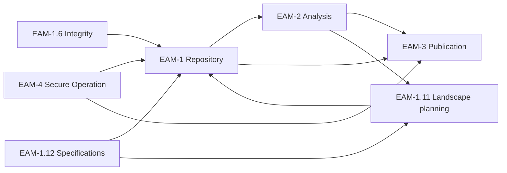

# Neko EAM – NATO Architecture Framework v4 (NAFv4) Description

This document describes **Neko EAM** with the NAFv4 viewpoint grid. It covers two views:

* **The system itself:** the software architecture of Neko EAM (backend, Fiori UI, desktop,
  approuter, XSUAA).
* **The meta model** that Neko EAM manages for its users, mapped onto NAFv4 concepts, so that an
  EAM repository can serve as a source for NAF architecture products.

Diagrams are in [uml.md](uml.md). Setup and configuration are in [README.md](README.md).

---

## A – Architecture Meta-Data

### A1 Meta-Data Definitions

| Item | Value |
|---|---|
| Architecture name | Neko EAM – Enterprise Architecture Management |
| Version | 2.10.0 (2026-11-12) |
| Scope | Repository, analysis and publication of enterprise architecture information (applications and application groups, product catalogue and product groups, capabilities, technology, flows, organisations, projects, IT landscape planning, architecture specifications, project management, access management, organisation structure, multi-tenancy, backup and restore, IT processes, information security, reporting) |
| Architecture type | Solution architecture of an EAM tool with hexagonal (Clean) architecture |
| Framework | NAFv4 (viewpoints C, S, L, P, A); UML 2 / Mermaid for notation; ArchiMate 3.1 for exchange |

### A2 Architecture Products

| Product | Location | NAF viewpoint |
|---|---|---|
| README.md | repository root | A1, A4, A8 |
| uml.md (class, component, sequence, deployment, use case, state diagrams) | repository root | L1, L4, L6, L7, P1, P2, P3, P5 |
| Meta model (labels, groups, types, references, enumerations; generated) | `/api/v1/model`, `eam fields <Set>` | A1, L7, S7 |
| nafv4.md (this document) | repository root | all |
| OData `$metadata` (CSDL, generated) | `/odata/v4/eam/$metadata` | S3, S7, L7 |
| ArchiMate exchange file (generated from the repository content) | `/api/v1/export/archimate`, `eam export archimate` | C1, L2, P3 (content level) |
| `xs-security.json` | `approuter/` | S8, P8 |

### A3 Architecture Correspondence

| Repository element (Neko EAM) | NAFv4 concept | ArchiMate export |
|---|---|---|
| BusinessCapability | Capability (C1, C3) | Capability |
| Application | Resource – Software / Application (P1, P4) | ApplicationComponent |
| ITComponent | Resource – Software / Platform / Hardware (P1, P2) | SystemSoftware / Device |
| InformationFlow | Resource interaction / Logical information flow (L3, P3) | Flow relationship |
| Organization (organisational unit) | Actor / Organisation (L1, P2) | BusinessActor |
| Enterprise (legal entity) | Organisation / enterprise with group structure (C1 context, L1, Lr Organisation) | BusinessActor (Aggregation subsidiary, Association to its top-level units) |
| ITProcess / ProcessStep | Standard process / operational activity of the IT organisation (C4, L4); ITIL 4 practice | BusinessProcess (Composition) |
| ProcessKpi | Measure of effectiveness / performance parameter (C5, C6) | – |
| ProtectionRequirement | Security classification / protection needs of information and resources (S8, L7, P8) | – |
| SecurityRisk | Risk (security viewpoint, S8 / P8 of the managed enterprise) | Assessment |
| SecurityControl | Security policy / control (S8, P8 of the managed enterprise) | Requirement |
| Report / ReportBook | Architecture product definition (A2) | – |
| Comment (journal of every element) | Architecture metadata / change history of an element (A6 on element level) | – |
| Tenant (platform level) | Separate enterprise / architecture repository (C1 context; Lr Organisation) | – |
| Backup | Architecture repository snapshot / configuration baseline (A6, P7) | – |
| Member | Post / person filling a role in an organisation (L1, P2 people, Lr) | – (personal data, not exported) |
| Project | Project / Capability increment (C7, Lr) | WorkPackage |
| SubProject | Project structure – sub project (Lr, P6 project view of the managed enterprise) | WorkPackage (Composition) |
| User / Role / Permission | Security viewpoint: actor accounts, role, access right per information element (S8, P8, Lr Organisation) | – (not exported) |
| WorkPackage | Project activity / WBS element with milestones and dependencies (Lr) | WorkPackage (Composition, Triggering) |
| Application → Capability | Capability realisation (C1 ↔ P4) | Realization |
| ITComponent → Application | Resource composition / serving (P2) | Serving |
| Product (software product version) | Resource type – Software / standard product (P1), standards profile (A8 of the managed enterprise) | SystemSoftware |
| ProductGroup | Resource type taxonomy (P1), grouping of standards | Grouping (Aggregation) |
| ApplicationGroup | Resource structure – application domain / landscape (P2) | Grouping (Aggregation) |
| BusinessProcess | Standard process / operational activity (C4, L4) | BusinessProcess (Composition) |
| BusinessData | Information element / logical data entity (L7), with DPIA rating as a security attribute (S8) | BusinessObject |
| ServiceProductGroup | Service taxonomy / service catalogue (S1, S2) | Grouping (Aggregation) |
| StrategicGuideline | Enterprise vision / guiding principle (C2), architecture principle of the managed enterprise (A7) | Principle |
| ServiceCapability | Capability of the IT service provider with current / target maturity (C1, C3; S1 ↔ C1) | Capability |
| MeasureGroup | Capability roadmap stream / programme (C7, Lr) | Grouping (Aggregation) |
| Measure | Project activity / capability increment (C7, Lr), affects resources (P1, P2) | WorkPackage |
| ArchitecturePrinciple | Architecture principle (A7 of the managed enterprise, C2) | Principle |
| ArchitectureGuideline | Standard / rule (A8 of the managed enterprise), mandatory guidelines as constraints (S8, P8) | Constraint / Requirement |
| ReferenceArchitecture | Reference architecture / architecture pattern (L2, P2 templates) | Grouping (Aggregation of building blocks) |
| ArchitectureDocument | Architecture product / view description (A2), architecture decision (A4) | Representation |
| Measure → Application / ITComponent / ServiceCapability / StrategicGuideline | Capability increment changes resources and implements principles (C7 ↔ P2, C2) | Association |
| Organization (extended: architect, contact, status, service totals) | Actor / Organisation, responsibility (L1, Lr Organisation) | BusinessActor |
| BusinessData → Organization / BusinessCapability | Information ownership, capability information needs (C1 ↔ L7) | Association |
| Application → Product (used / assigned) | Resource composition (P2) | Serving / Association |
| Product / Application group → IT capability | Capability configuration (C1 ↔ P1) | Association |

### A4 Methodology Used

* Hexagonal / Clean Architecture: domain → application → ports ← adapters (persistence, presentation).
* Model-driven adapters: one DTO registry, from which OData metadata, CLI, web cockpit and GtkD client are generated at compile time.
* Rules declared as D user-defined attributes (`@Required`, `@DateField`, `@References`) and evaluated generically.
* Presentation metadata as UDAs on the DTOs (`@Label`, `@Group`, `@ReadOnly`, `@ListColumn`, `@Multiline`).
  They are published as the meta model, and the Fiori pages and GtkD dialogs are generated from it. No screen is coded per entity.
* Test strategy: D unit tests per module, an integration test across all layers, QUnit (formatters,
  field factory) and OPA5 (shell bar user, profile, sidebar navigation, object page).

### A5 Architecture Status

| Area | Status |
|---|---|
| Domain, use cases, persistence (JSON) | implemented, tested |
| OData v4 (CRUD, `$filter/$orderby/$select/$top/$skip/$count/$search`) | implemented, tested |
| REST analyses, ArchiMate export, web cockpit | implemented, tested |
| CLI (local and `--remote`) | implemented, tested |
| Product catalogue (Product, ProductGroup), ApplicationGroup, product assignment & roll-up, product lifecycle alerts | implemented, tested (unit, integration, UI) |
| Business architecture (BusinessProcess, BusinessData, extended Organization and BusinessCapability), service catalogue (ServiceProductGroup), hierarchy paths, creator | implemented, tested (unit, integration, UI) |
| OpenUI5 shell (Fiori 3 ShellBar with central search and user profile, SideNavigation), search result page, generic list / object pages | implemented, tested (QUnit, OPA5, headless browser) |
| IT landscape planning (StrategicGuideline, ServiceCapability, MeasureGroup, Measure), maturity gap, measure roll-up | implemented, tested (unit, integration, OPA5, headless browser) |
| Specifications (ArchitecturePrinciple, ArchitectureGuideline, ReferenceArchitecture, ArchitectureDocument), document count, review overdue | implemented, tested (unit, integration, OPA5, headless browser) |
| Project management (extended Project, SubProject, WorkPackage), effort-weighted progress roll-up, delay flag | implemented, tested (unit, integration, OPA5, headless browser) |
| Access management (User, Role, Permission), authorization of every channel (OData, REST, import/export, search, web cockpit, CLI, GtkD), rights-aware Fiori UI, local *Act as* | implemented, tested (unit, integration, HTTP, OPA5, headless browser); GtkD compiled, not run; XSUAA mode not yet tested on BTP |
| Organisation structure (Enterprise, extended Organization, Member), staffing roll-up, derived managing director | implemented, tested (unit, integration, OPA5, headless browser) |
| Comment journal on every element (append-only, rights of the element, cascade on delete, part of backups) | implemented, tested (unit, integration, HTTP, OPA5, headless browser); GtkD dialog compiled, not run |
| Processes (ITProcess, ProcessStep, ProcessKpi with KPI evaluation), information security (ProtectionRequirement, SecurityRisk, SecurityControl with scoring), reporting (Report, ReportBook; run with the caller's rights; XLSX / CSV / PDF) | implemented, tested (unit, integration, HTTP, CLI, OPA5, headless browser, PDF checked with poppler); GtkD maintains the elements but does not run reports |
| Multi-tenancy (tenant registry, data file per tenant, zone / selection based resolution, tenant administration), backup (manual, scheduled with retention, safety backups, SHA-256) and restore (check, atomic replace) | implemented, tested (unit, integration, HTTP, CLI, OPA5, headless browser); GtkD only tenant selection (`EAM_TENANT`); SaaS subscription callbacks not implemented |
| CSV / XLSX import and export of every entity set (REST, Fiori, CLI, GtkD, web cockpit), dry run | implemented, tested (unit, integration round trip, LibreOffice interoperability, OPA5, headless browser); GtkD dialogs compiled, not run |
| Central search (REST, Fiori, CLI, GtkD) | implemented, tested (integration, OPA5, CLI); GtkD search compiled, not run |
| GtkD desktop client (sidebar, metadata-driven dialogs), WebView | implemented, smoke-tested |
| XSUAA JWT validation, approuter, MTA | implemented; still needs testing on a BTP subaccount |
| `$batch`, `$expand`, database storage, Unix socket adapter | planned |

### A6 Architecture Versions

| Version | Date | Change |
|---|---|---|
| 1.0.0 | 2026-11-12 | Initial architecture: six element kinds, five access channels, BTP deployment |
| 2.0.0 | 2026-11-12 | Product catalogue (Product with ~80 attributes, ProductGroup), ApplicationGroup, extended Application (object state, level ID, stakeholder, product totals), `modifiedBy` on all elements, product lifecycle alerts, meta model API, OpenUI5 shell with sidebar and user profile, metadata-driven Fiori and GtkD UIs |
| 2.1.0 | 2026-11-12 | Business processes, business data (DPIA), service product groups; extended organisations (short name, status, dates, architect, contact, stakeholder, service totals) and capabilities (level ID, mission criticality, stakeholder); hierarchy paths; `createdBy` (Creator) on all elements; central search in the shell bar, CLI and GtkD |
| 2.2.0 | 2026-11-12 | CSV and XLSX import / export for every entity set and the whole repository (upsert by ID, dry run on a sandbox copy, row-level error report, dependency order with retries, spreadsheet conventions, CSV injection guard) |
| 2.3.0 | 2026-11-12 | IT landscape planning (*IT-Bebauungsplanung*): strategic guidelines, service capabilities (current / target maturity, derived maturity gap), measure groups (roll-up of measure count and estimated cost) and measures (type, priority, planning status, progress, links to guidelines, service capabilities, applications, IT components and projects); new sidebar group, ArchiMate mapping, import / export |
| 2.4.0 | 2026-11-12 | Specifications: architecture principles (statement, rationale, implications), architecture guidelines (obligation, compliance verification, standard products), reference architectures (hierarchy, building blocks, derived document count) and architecture documents (type, confidentiality, approval, review cycle with derived *Review Overdue*); new sidebar group, ArchiMate mapping, import / export; fix: boolean list columns in Fiori |
| 2.5.0 | 2026-11-12 | Project management: projects extended (project number, manager, phase, priority, actual cost, rolled-up totals and effort-weighted progress), sub projects (nested, path, roll-up) and work packages (WBS code, effort, cost, progress, predecessors, implemented measures, derived *Delayed*); own sidebar group (projects moved out of *Integration & Transformation*) |
| 2.6.0 | 2026-11-12 | Access management: users, roles and permissions (read / create / update / delete per entity set or *All*); authorization in the application layer for every channel (checked use cases, HTTP 403); XSUAA `Display` = sign-in, `Admin` = administrator (break-glass); approuter requires `Display` for all methods; rights-aware Fiori navigation and buttons, *Act as* for local development, CLI `--user` / `rights`, `EAM_USER` for the desktop |
| 2.7.0 | 2026-11-12 | Organisation structure (*Aufbau*): enterprises (legal entities, group structure, ownership share, derived managing director), organisational units linked to their legal entity with cost center and derived head / members / FTE, members (function, employment type, capacity, period, line manager, user account); own sidebar group (units moved out of *Business Architecture*); role *Organisation Manager*; labels unique per set (checked by a unit test) |
| 2.10.0 | 2026-11-12 | Running comments (journal) on every element: date, author, text; append-only, delete by author or with delete permission; Fiori section *Comments*, desktop dialog, CLI `comments` / `comment`, REST `/api/v1/comments`; removed together with the element, included in backups |
| 2.9.0 | 2026-11-12 | Processes (IT processes, steps, KPIs with derived status; business processes moved into the group), security (protection requirements with maximum principle, risks with scoring and residual risk, controls with overdue / mitigated risks), reporting (report definitions with $filter / $orderby / group / sum, report books, Fiori result page, XLSX / CSV / PDF export, CLI and REST); OData query engine moved to the application layer; roles *Process Manager* and *Information Security Officer* |
| 2.8.0 | 2026-11-12 | Multi-tenancy (*Mandantenfähigkeit*): isolated tenants with own data file and access management, tenant resolution by XSUAA zone or selection, tenant administration (system administrators, scope `SystemAdmin`); backup (*Datensicherung*): gzip JSON with SHA-256 checksum, manual / scheduled (retention) / safety backups, download; restore (*Wiederherstellung*): check, safety backup, atomic replace, copy between tenants; Fiori pages *Backup & Restore* and *Tenants*, tenant in the shell bar; fix: collection reference columns in Fiori lists |

### A7 Architecture Compliance

* SAP Fiori 3 design guidelines (sap_fiori_3 theme family, ShellBar with profile, ToolPage + SideNavigation,
  DynamicPage, ObjectPage with display/edit mode and footer toolbar, semantic colours).
* OData v4.0 Protocol (subset, see A5), CSDL XML.
* ArchiMate 3.1 Model Exchange File Format.
* SAP BTP security model (XSUAA, scopes, role collections, approuter CSRF protection).

### A8 Standards

| Category | Standard / Technology |
|---|---|
| Language / runtime | D 2.112 (dmd / ldc2), dub |
| Web framework | vibe.d 0.10.3 (vibe-core 2.x, vibe-http 1.x), Diet templates |
| UI | OpenUI5 1.120 LTS (`sdk.openui5.org`), sap.m / sap.f / sap.tnt / sap.uxap / sap.ui.layout, daisyUI 4 (web cockpit) |
| Desktop | GTK 3 via GtkD 3.11, WebKit2GTK 4.1 |
| Interfaces | OData v4, REST/JSON, ArchiMate XML |
| Security | OAuth 2.0 / JWT (RS256), OpenSSL 3, TLS |
| Platform | SAP BTP Cloud Foundry, MTA 3.1, @sap/approuter |

---

## C – Concepts

### C1 Capability Taxonomy

The capabilities that **Neko EAM provides** to its users:

```
EAM-1 Architecture Repository Management
  EAM-1.1 Application portfolio management
  EAM-1.2 Business capability modelling (hierarchy L1..L5)
  EAM-1.3 Technology (IT component) lifecycle management
  EAM-1.7 Product catalogue management (product versions, product groups, licensing, compliance)
  EAM-1.8 Application grouping and product assignment (used / assigned products, roll-up)
  EAM-1.4 Information flow / interface management
  EAM-1.5 Organisation and project management (legal entities, organisational units, members and staffing; projects, sub projects, work packages, progress roll-up)
  EAM-1.6 Referential integrity and data quality
  EAM-1.9 Business process and business data management (process map, data catalogue, DPIA rating)
  EAM-1.10 Service catalogue management (service product groups, catalogue releases)
  EAM-1.11 IT landscape planning (strategic guidelines, service capabilities and maturity, measure groups, measures)
  EAM-1.12 Architecture specifications (principles, guidelines, reference architectures, documents with review cycle)
  EAM-1.13 IT process management (IT processes, steps, KPIs)
  EAM-1.14 Information security management (protection requirements, risks, controls)
EAM-2 Architecture Analysis
  EAM-2.1 Portfolio rationalisation (Gartner TIME)
  EAM-2.2 Technology risk analysis (end of support, phase-out)
  EAM-2.3 Capability coverage (gaps, redundancies)
  EAM-2.4 Impact analysis
  EAM-2.5 Product lifecycle monitoring (EoL / EoS / EoSu, BSI permission, reminders, blacklist)
EAM-3 Architecture Publication & Exchange
  EAM-3.1 OData v4 / REST interfaces
  EAM-3.2 ArchiMate exchange export
  EAM-3.3 Dashboards (Fiori, web cockpit, desktop)
  EAM-3.4 Central search across all repository elements
  EAM-3.5 Data exchange with spreadsheets (CSV / XLSX import and export)
  EAM-3.6 Reporting (report definitions, report books, XLSX / CSV / PDF)
EAM-4 Secure Operation
  EAM-4.1 Authentication (XSUAA) & authorisation (users, roles, permissions per entity set)
  EAM-4.2 Audit trail (domain events, last update user per element, comment journal per element)
  EAM-4.4 Personalisation (user profile: language, theme)
  EAM-4.3 Architecture health monitoring (background worker)
  EAM-4.5 Backup & recovery (manual / scheduled backups, checked restore, safety backups)
  EAM-4.6 Multi-tenancy (isolated tenants, tenant administration)
```

The demo repository uses the capability taxonomy of the **managed enterprise**:
Customer Management (CRM, Campaign Management), Finance & Controlling (Accounts Payable, Management Reporting),
Human Resources and the IT capability branch *IT Platform Services* (Data Management, Application Runtime). The
product and application groups are linked to that branch.

### C2 Enterprise Vision

*Transparent, decision-ready enterprise architecture.* Architects maintain one consistent repository.
Stakeholders see the state of the portfolio, the risks and the gaps in the channel that suits them:
browser, desktop, scripts or integrations. Decisions (invest, migrate, eliminate) are based on
explicit assessments rather than spreadsheets.

### C3 Capability Dependencies



### C4 Standard Processes

| Process | Steps | Channels |
|---|---|---|
| Portfolio review | maintain BV/TF scores → run TIME assessment → review deviations → set TIME category → create project | Fiori, GtkD, CLI |
| Technology obsolescence | maintain end-of-support dates → technology risk report → plan migration project | Fiori analysis tab, health worker log |
| Capability planning | maintain capability map → coverage analysis → close gaps / remove redundancies | Fiori, web cockpit |
| Change impact | select application → impact analysis (flows, dependents, projects) → decide | Fiori object page, CLI `analyze impact` |
| Architecture exchange | export ArchiMate → import into modelling tool | REST, CLI, GtkD |
| Product approval | requester enters product version → approval status Requested → InReview → Approved / ApprovedWithConditions / Rejected (blacklisted products cannot be approved) | Fiori object page, CLI |
| Product lifecycle | maintain milestones and reminder lead times → reminder dates derived → product alerts (shell bar notifications, analysis) → plan replacement | Fiori, GtkD, CLI `analyze products`, web cockpit |
| Application landscape | assign applications to application groups and products → group totals rolled up → review usage per group | Fiori, CLI |
| Data protection | maintain business data → DPIA rating → owner organisation required from *Medium* → link capabilities and information flows | Fiori, CLI |
| IT landscape planning | adopt strategic guidelines (owner, rationale) → assess service capabilities (current / target maturity → gap) → bundle measures in measure groups → link measures to guidelines, capabilities, affected applications / IT components and the implementing project → Proposed → Approved → InProgress → Completed (group totals rolled up) | Fiori, CLI, GtkD, Excel import |
| Architecture governance | derive principles from strategic guidelines → approve (owner, statement, rationale) → derive checkable guidelines (mandatory → constraint) and name standard products → assemble reference architectures → document (concept, ADR, specification) → approve → review cycle (*Review Overdue*) | Fiori, CLI, GtkD, Excel import |
| Project execution | create project (number, manager, phase) → structure into sub projects → plan work packages (WBS code, effort, cost, predecessors, measures) → report progress → project / sub project progress rolled up, delayed work packages flagged → close | Fiori, CLI, GtkD, Excel import |
| Organisation maintenance | maintain legal entities (group structure, ownership) → assign organisational units to their legal entity and cost center → assign members (function, capacity, period, line manager, user account) → heads, FTE and managing directors derived | Fiori, CLI, GtkD, Excel import |
| Status documentation | open element → read the journal (newest first) → add a comment on the current state or a change → author and date recorded → correct by deleting the own entry and adding a new one | Fiori object page, desktop, CLI, REST |
| IT process improvement | model IT process and steps (responsibility, automation, applications) → define KPIs (target, threshold) → record measurements → KPI status / worst KPI per process → raise maturity | Fiori, CLI, Excel import |
| Information security | protection requirement per application / data / component (maximum principle) → identify risks (likelihood × impact) → assign controls → track implementation (overdue) → residual risk → accept or treat | Fiori, CLI, reports *High and critical security risks* |
| Reporting | define report (set, columns, filter, grouping) → run with own rights → export XLSX / CSV / PDF → bundle in report books for boards | Fiori result page, CLI `report`, REST |
| Backup & restore | scheduled backup (daily, retention) / manual backup before larger changes → download for off-site storage → on data loss or mistakes: check backup → confirm → safety backup + restore → app reloads | Fiori *Backup & Restore*, CLI `backup`, REST |
| Tenant onboarding | system administrator creates tenant (id, name, zone, administrator user, optional demo data) → tenant administrator maintains users / roles / permissions → users switch tenant in the profile (or are routed by their zone) | Fiori *Tenants*, CLI `tenants`, REST |
| Access administration | define permissions (set + read / create / update / delete) → bundle them in roles → assign roles to users (user name = login / e-mail) → check *Effective Rights* → deactivate or expire leavers | Fiori, CLI (`rights`), Excel import |
| Service catalogue release | maintain catalogue tree (service product groups) → version → status *Released* with date of release | Fiori, CLI |
| Bulk maintenance | export set (Excel) → edit offline / collect from departments → import → Check (dry run, row errors) → Import | Fiori, CLI `export`/`import`, GtkD |
| Find & navigate | type in the shell bar search → suggestion opens the object page, or Enter → result page filtered by type | Fiori, CLI `search`, GtkD |

### C5 Effects

* Lower run costs because redundant applications are identified (redundancies, Eliminate/Migrate).
* Lower operational risk because outdated technology is visible early.
* Compliance: blacklisted and unapproved products, expired BSI permissions and overdue validations are visible.
* Faster change because impacts are known before they happen.
* Traceable IT strategy: every measure points to the guidelines it implements and the capabilities it improves;
  rejected measures document guideline violations.

### C6 Performance Parameters

| Parameter | Target |
|---|---|
| OData list response (≤ 1,000 elements, in-memory) | < 50 ms |
| Start-up time (server, incl. JSON load) | < 1 s |
| Data durability | every change is written atomically (tmp + rename) before the response is sent |
| Availability (BTP) | CF health check on `/health` |
| Recovery point objective (RPO) | ≤ `backupIntervalHours` (default 24 h) – plus manual backups before larger changes |
| Recovery time objective (RTO) | minutes: check + restore of a stored backup is one atomic file write per tenant |

### C7 Capability Roadmap

| Increment | Content |
|---|---|
| 1.0 | Repository, analyses, OData/REST, Fiori, GtkD, WebView, CLI, BTP deployment |
| 2.0 | Product catalogue, application groups, product lifecycle alerts, meta model API, OpenUI5 shell with sidebar and user profile |
| 1.1 | PostgreSQL storage (`IDocumentStorage`), multi-instance operation |
| 1.2 | OData `$batch` / `$expand`, navigation properties |
| 1.3 | Gateways to CMDB / ticketing (ports/gateways), import of ArchiMate models |
| 2.1 | Product approval workflow with notifications (reminder e-mails from the health worker) |
| 2.3 (current) | IT landscape planning: strategic guidelines, service capabilities, measure groups, measures |
| 3.0 | Time-sliced architecture (as-is / to-be states) derived from the measures, roadmaps per capability |

### C8 Enterprise Signals

Domain events (`Created`, `Updated`, `Deleted` with kind, id, name, timestamp) are published via
`IEventPublisher`. Today they go to the audit log. A message broker can be attached later with a
different publisher implementation. The health worker periodically reports risk counts, gaps and TIME deviations.

---

## S – Service Specifications

### S1 Service Taxonomy

| Service | Type | Interface |
|---|---|---|
| EamService (OData) | Data service | `/odata/v4/eam/` |
| Analysis service | Business service | `/api/v1/analysis/*` |
| Meta model service | Technical service | `/api/v1/model` |
| Search service | Business service | `/api/v1/search` |
| Transfer service | Data service | `/api/v1/transfer`, `/api/v1/transfer/{Set}` (CSV, XLSX) |
| User service | Technical service | `/api/v1/me` |
| Export service | Business service | `/api/v1/export/archimate` |
| Administration | Technical service | `/api/v1/admin/seed`, `/health` |
| Comment service | Business service | `/api/v1/comments/{set}/{id}`, `/api/v1/comments/{commentId}` |
| Reporting service | Business service | `/api/v1/reports/{id}/run|export`, `/api/v1/reports/run`, `/api/v1/reportbooks/{id}/run|export` |
| Tenant service | Technical service | `/api/v1/tenants[/{id}]` (system administrators) |
| Backup service | Technical service | `/api/v1/backups[/{id}[/restore]]`, `/api/v1/backups/restore` (tenant administrators) |
| Web cockpit | Presentation service | `/web`, `/web/sets/{set}` |

### S2 Service Structure

All services are composed in one deployable unit (`eam serve`). They share one use case facade
(`IEamUseCases`). The approuter is the single entry point in the cloud.

### S3 Service Interfaces

| Interface | Operations |
|---|---|
| OData entity sets: `Applications`, `ApplicationGroups`, `Products`, `ProductGroups`, `BusinessCapabilities`, `BusinessProcesses`, `BusinessData`, `ITComponents`, `InformationFlows`, `Organizations`, `Projects`, `ServiceProductGroups`, `StrategicGuidelines`, `ServiceCapabilities`, `MeasureGroups`, `Measures`, `ArchitecturePrinciples`, `ArchitectureGuidelines`, `ReferenceArchitectures`, `ArchitectureDocuments`, `SubProjects`, `WorkPackages`, `Enterprises`, `Members`, `Users`, `Roles`, `Permissions` (each only with the permission to read / write it) | GET collection (`$filter`, `$orderby`, `$select`, `$top`, `$skip`, `$count`, `$search`), GET `/$count`, GET/PATCH/PUT/DELETE by key, POST |
| `GET /api/v1/analysis/portfolio` | PortfolioReportDto (counts, KPIs, TIME assessments, technology risks) |
| `GET /api/v1/analysis/coverage` | CapabilityCoverageDto[] |
| `GET /api/v1/analysis/risks` | TechnologyRiskDto[] |
| `GET /api/v1/analysis/impact/{id}` | ImpactReportDto |
| `GET /api/v1/analysis/products` | ProductAlertDto[] (severity, kind, product, date, message, affected applications) |
| `GET /api/v1/model` | EntitySetInfoDto[] (fields with label, group, type, required, readOnly, reference, choices, default) |
| `GET /api/v1/search?q=&top=` | SearchHitDto[] (set, type label, icon, id, name, description, matched field, snippet, score); `top` 1–200 |
| `GET /api/v1/transfer/{Set}?format=csv\|xlsx&sep=&headers=` · `GET /api/v1/transfer?format=xlsx` | CSV / XLSX file (attachment) of one set / all sets |
| `POST /api/v1/transfer/{Set}?dryRun=` · `POST /api/v1/transfer?dryRun=` | ImportResultDto / ImportResultDto[] (rows, created, updated, unchanged, failed, issues: row, id, field, message, severity) |
| `GET /api/v1/me` | UserInfoDto (name, display name, initials, e-mail, roles, canEdit, authMode) |
| `POST /api/v1/admin/seed` | number of created demo elements |
| `GET /api/v1/export/archimate` | ArchiMate XML (attachment) |

### S4 Service Functions

Create/read/update/delete architecture elements with validation and integrity checks; TIME
recommendation; technology risk detection; capability coverage incl. sub-capability roll-up;
impact analysis; product lifecycle alerts; application group roll-up of used / assigned products;
derived reminder dates; hierarchy paths; central search; CSV / XLSX import and export; meta model description; current user profile; ArchiMate export; demo data seeding.

### S5 Service States

Stateless HTTP services. The repository state lives in the storage (`data/eam.json`). Element
lifecycle: see uml.md §23; measure planning status: uml.md §24; work package status: uml.md §25.

### S6 Service Interactions

See uml.md §14 (create via OData through approuter), §15 (delete with integrity check), §17 (Fiori shell
start-up with user profile and meta model), §18 (object page edit and save with validation feedback) and
§19 (central search from the shell bar), §20 (CSV / XLSX import with dry run), §26 (authorization of a request) and §27 (restore a backup).

### S7 Service Interface Parameters

* Encoding: JSON (`application/json;odata.metadata=minimal`), XML for `$metadata` and ArchiMate.
* Header `OData-Version: 4.0`. Dates as `Edm.Date` (`YYYY-MM-DD` or `null`).
* Enumerations are transported as names (e.g. `"PhaseOut"`).
* Errors: `{"error": {"code": "ValidationError|InvalidQuery|NotFound|Conflict|ReferentialIntegrity|Unauthorized|Forbidden|InternalError", "message": "…", "target": "<field>"}}` with HTTP 400/404/409/401/403/500. `target` is only set for validation errors.
* Every change records `modifiedBy`: the token subject (OData), `<user>@cli` (CLI) or `<user>@gui` (GtkD).

### S8 Service Policy

| Policy | Rule |
|---|---|
| Sign-in | scope `<xsappname>.Display` (role collection `EAM_Viewer`), required by approuter and backend for every method |
| Read / write access | EAM permissions (read / create / update / delete per entity set) of the user's active roles; checked in the application layer for every channel; HTTP 403 otherwise |
| Administrator | scope `<xsappname>.Admin` (role collection `EAM_Architect`) bypasses the permissions (set-up, break-glass) |
| Unknown / disabled users | no access; without any users in the repository: read-only (bootstrap) |
| Comments | read / write with read access to the element; delete own comments, others' only with the delete permission on the set; author and date are set by the server |
| Reports | executed with the caller's permissions; sets without read access fail with 403, names of unreadable references are shown as ids |
| Tenant isolation | separate data file and access management per tenant; tenant from the XSUAA zone, or selected (`X-EAM-Tenant` / cookie) only as a user of that tenant; scope `<xsappname>.SystemAdmin` (`EAM_SystemAdministrator`) for tenant administration and every tenant |
| Backup / restore | tenant administrators (full rights incl. access management, or `Admin` scope) for their tenant, system administrators for all; restore only after a successful check, with an automatic safety backup; backups of another tenant only by system administrators |
| Personal data | members (name, e-mail, phone) only for users with read permission on *Members*; not exported to ArchiMate |
| Local development | `authMode=none`: OS user is administrator; *Act as* (cookie `eam-dev-user`), CLI `--user`, `EAM_USER` - ignored with XSUAA |
| Token validation | RS256 signature, `exp`, client id / audience |
| CSRF | enforced by approuter for modifying requests |
| Transport | HTTPS (approuter / CF router, or backend TLS via `tlsCertificateFile`) |
| Secrets | only in service bindings / `default-env.json` (git-ignored) |

---

## L – Logical Specifications

### L1 Node Types

| Logical node | Responsibility |
|---|---|
| User agent (browser / WebView) | Renders the Fiori UI (shell bar with user profile, side navigation, generic pages) |
| Desktop client | GtkD UI and CLI working on the use cases |
| Entry point (approuter) | Login, session, routing, CSRF |
| Identity provider (XSUAA) | Issues JWTs, scopes |
| EAM service | Use cases, OData/REST/web, persistence |
| Repository store | Persists architecture documents |

### L2 Logical Scenario

An enterprise architect logs in through the approuter. The shell bar shows the architect's initials and
two critical notifications. The overview lists 5 product alerts: *Oracle Database 11.2* is past end of
life and still used by *Legacy Customer DB* and *Corporate BI*, and the blacklisted *WinRAR* is used by
*Legacy Customer DB*. The architect opens the product from the alert and checks its *Where Used*
section, then opens *Legacy Customer DB* (impact: dependent Sales Cloud CRM, project CRM Consolidation).
The architect sets the TIME category to *Migrate* and replaces the used products. The *CRM Landscape*
application group totals and the KPIs update. Every change is stamped with the architect's user name.

### L3 Node Interactions

| From | To | Information |
|---|---|---|
| User agent | Entry point | UI resources, OData/REST requests (session cookie) |
| Entry point | Identity provider | OAuth2 authorization code flow |
| Entry point | EAM service | Requests + forwarded JWT |
| EAM service | Identity provider | (offline) verification key from service binding |
| Desktop client | EAM service | OData (`--remote`, WebView) or in-process calls |
| EAM service | Repository store | Element documents (JSON) |

### L4 Logical Activities

Maintain element → validate → check references → persist → publish event; analyse → aggregate
repository → apply domain service → return report; export → transform repository to ArchiMate.

### L5 Logical States

Element: *non-existent → stored → modified\* → deleted* (deletion only if not referenced).
Application lifecycle: Plan → Build → Active ⇄ PhaseOut → Retired.
Measure: Draft → Proposed → Approved → InProgress → Completed (or Rejected / Cancelled).
Work package: NotStarted → InProgress ⇄ OnHold → Completed (or Cancelled); Delayed if open after its end date.
Specification (principle, guideline, reference architecture, document): Draft → InReview → Approved → Deprecated / Withdrawn.

### L6 Logical Sequence

uml.md §14–§20, §26, §27.

### L7 Logical Data Model

uml.md §1–§11 (domain and platform class diagrams). It is published as CSDL at `/odata/v4/eam/$metadata`
(namespace `EamService`, thirty-five entity types, key `id`). The presentation-level description (labels,
groups, enumeration values) is at `/api/v1/model`.

### L8 Logical Constraints

Business rules from README §1: mandatory name; scores 1–5; non-negative amounts; date formats and
order; retired applications need a retirement date; level 1 capabilities have no parent; flows
need different source and target; groups cannot be their own parent; blacklisted products cannot be
approved; product weblinks are http(s) URLs; data-quality index 0–100; non-negative counters and reminder
lead times; active applications cannot be archived; organisations past their end date cannot be active;
active business processes need an owner; business data with a medium/high DPIA rating needs an owner;
released service product groups need a date of release; active strategic guidelines need an owner and a
rationale; service capability maturity 1–5; approved measure groups and approved / running measures need a
responsible person; running measures need a start date; completed measures are at 100 %; retire / migrate
measures name the affected applications or IT components; approved principles need owner, statement and
rationale; mandatory architecture guidelines are derived from a principle; approved reference architectures
need an architect and a principle or guideline; approved documents need approver and approval date; document
links are http(s) URLs; sub projects and work packages need a project; running sub projects need a manager,
running work packages a responsible and a start date; completed work packages are at 100 %; no self-predecessor;
completed projects need an end date; user names and personnel numbers are unique; one current head per unit;
member capacity 1–100 %; IT process / step / KPI, protection requirement, risk, control and report rules (README §1); external members need an end date; ownership share 0–100 % with a parent; permissions that allow writing allow reading;
referential integrity on create/update/delete.

---

## P – Physical Resource Specifications

### P1 Resource Types

| Resource | Type |
|---|---|
| `eam` | Native executable (D, desktop configuration: server, CLI, GtkD, WebView) |
| `eam-headless` | Native executable (server, CLI) for servers and Cloud Foundry |
| `frontend/` | Static OpenUI5 application (UI5 libraries loaded from the OpenUI5 CDN) |
| `@sap/approuter` | Node.js application |
| XSUAA | Managed BTP service (plan `application`) |
| `data/eam.json` | JSON document file |
| GTK 3, WebKit2GTK 4.1, OpenSSL 3 | Shared system libraries |

### P2 Resource Structure

Backend module structure (README §2): `domain`, `application`, `ports`, `infrastructure`,
`persistence`, `presentation`, `composition.d`, `app.d`. Component diagram: uml.md §13.

### P3 Resource Connectivity

Deployment diagram: uml.md §21. Browser ⇄ approuter (HTTPS), approuter ⇄ backend (HTTPS via
destination `eam-backend`), approuter ⇄ XSUAA (OAuth2). Locally: browser/WebView ⇄ backend on
`127.0.0.1:8080`, approuter on `:5000` with `default-env.json`.

### P4 Resource Functions

| Resource | Functions (capability mapping) |
|---|---|
| presentation/odata | EAM-3.1 |
| presentation/rest, application/usecases/analyzeportfolio | EAM-2.x |
| application/services/archimateexporter | EAM-3.2 |
| presentation/web, frontend, presentation/gui | EAM-3.3 |
| application/usecases/manageelements, services/integrityservice | EAM-1.x, EAM-1.6 |
| domain/services/productlifecycle (ProductLifecycleMonitor, ApplicationGroupRollup) | EAM-2.5, EAM-1.8 |
| domain/services/hierarchy (hierarchyPath) | EAM-1.2, EAM-1.5, EAM-1.9, EAM-1.10 |
| domain/services/projectrollup (ProjectRollup), domain/services/planning (MeasureGroupRollup) | EAM-1.5, EAM-1.11 |
| application/usecases/searchelements, presentation/rest (`/search`), frontend Search view | EAM-3.4 |
| application/usecases/transferelements, infrastructure/formats (CsvCodec, XlsxCodec), presentation/http/transfer, frontend TransferHelper / ImportDialog | EAM-3.5 |
| application/dtos/modelinfo, presentation/rest (`/model`, `/me`) | EAM-3.1, EAM-3.3, EAM-4.4 |
| infrastructure/security, approuter | EAM-4.1 |
| application/usecases/reporting, application/services/queryengine, infrastructure/formats/pdfreport, presentation/http/reports | EAM-3.6 |
| application/usecases/platform (EamPlatform), application/services/backupcodec, tenantrouting, persistence (TenantRegistry, FileTenantStorageProvider, BackupFileStore), presentation/http/system, infrastructure/workers (backup worker) | EAM-4.5, EAM-4.6 |
| application/usecases/accesscontrol (AccessControlInteractor, SecuredEamFacade), domain/services/accesspolicy (EffectiveRights), presentation/http/access | EAM-4.1 |
| infrastructure/logging (LoggingEventPublisher) | EAM-4.2 |
| infrastructure/workers | EAM-4.3 |

### P5 Resource States

Process modes: `serve` (event loop), `gui` (GTK main loop), `webview` (GTK main loop in the main thread plus a
vibe.d server in a daemon thread), CLI (one-shot, exit code 0/1/2/3).

### P6 Resource Sequence

Start-up: load configuration (defaults → JSON → env → VCAP) → open storage → wire container →
seed if empty → start listener → start health worker → run event loop.

### P7 Physical Data Model

```json
{
  "format": "neko-eam",
  "version": 1,
  "collections": {
    "Applications":         [ { "schemaVersion": 1, "id": "app-crm", "name": "...", "status": "Active", "capabilityIds": ["cap-crm"], "...": "..." } ],
    "BusinessCapabilities": [ ... ],
    "ITComponents":         [ ... ],
    "InformationFlows":     [ ... ],
    "Organizations":        [ ... ],
    "Projects":             [ ... ],
    "Products":             [ { "schemaVersion": 1, "id": "prd-oracle-11", "productVersion": "11.2.0.4", "endOfLife": "2022-12-31", "isBlacklisted": false, "...": "..." } ],
    "ProductGroups":        [ ... ],
    "ApplicationGroups":    [ ... ],
    "BusinessProcesses":    [ { "schemaVersion": 1, "id": "bp-r2r-close", "parentProcessId": "bp-r2r", "processOwner": "...", "...": "..." } ],
    "BusinessData":         [ { "schemaVersion": 1, "id": "bd-customer", "dpiaRating": "High", "informationFlowIds": ["if-crm-s4"], "...": "..." } ],
    "ServiceProductGroups": [ ... ],
    "StrategicGuidelines":  [ { "schemaVersion": 1, "id": "sg-cloud", "category": "Architecture", "status": "Active", "...": "..." } ],
    "ServiceCapabilities":  [ { "schemaVersion": 1, "id": "sc-data", "currentMaturity": 2, "targetMaturity": 4, "...": "..." } ],
    "MeasureGroups":        [ ... ],
    "Measures":             [ { "schemaVersion": 1, "id": "ms-java", "measureType": "Modernize", "status": "InProgress", "progress": 60, "...": "..." } ],
    "ArchitecturePrinciples": [ ... ],
    "ArchitectureGuidelines": [ { "schemaVersion": 1, "id": "ag-openapi", "obligation": "Mandatory", "principleIds": ["ap-api"], "...": "..." } ],
    "ReferenceArchitectures": [ ... ],
    "ArchitectureDocuments":  [ { "schemaVersion": 1, "id": "doc-adr-k8s", "documentType": "Decision", "nextReviewDate": "2026-05-15", "...": "..." } ],
    "SubProjects":          [ { "schemaVersion": 1, "id": "sp-crm-quality", "projectId": "prj-crm-consolidation", "parentSubProjectId": "sp-crm-migration", "...": "..." } ],
    "WorkPackages":         [ { "schemaVersion": 1, "id": "wp-crm-load", "wbsCode": "1.1.3", "plannedEffortDays": 50, "progress": 20, "predecessorIds": ["wp-crm-cleansing"], "...": "..." } ],
    "Comments":             [ { "schemaVersion": 1, "id": "cmt-…", "elementSet": "Applications", "elementId": "app-legacycrm", "text": "...", "createdAt": "...", "createdBy": "m.weber" } ],
    "Enterprises":          [ { "schemaVersion": 1, "id": "ent-acme-it", "legalForm": "GmbH", "parentEnterpriseId": "ent-acme", "ownershipShare": 100, "...": "..." } ],
    "Members":              [ { "schemaVersion": 1, "id": "mem-krueger", "personnelNumber": "P-4115", "organizationId": "org-it-ops", "capacity": 80, "userId": "usr-krueger", "...": "..." } ],
    "Users":                [ { "schemaVersion": 1, "id": "usr-becker", "userName": "j.becker", "active": true, "roleIds": ["role-project-manager", "role-app-owner"], "...": "..." } ],
    "Roles":                [ { "schemaVersion": 1, "id": "role-viewer", "status": "Active", "permissionIds": ["perm-read-all"], "...": "..." } ],
    "Permissions":          [ { "schemaVersion": 1, "id": "perm-read-all", "entitySet": "All", "canRead": true, "canCreate": false, "...": "..." } ]
  }
}
```

Records (`persistence/records`) are separate from entities and DTOs. Missing fields fall back to
defaults, and unknown enumeration values keep the default, which allows schema evolution. Older files
load without the new fields (e.g. `modifiedBy`, `objectState`). Application group totals are rolled up
at read time and are not stored; so are the hierarchy paths (*Organisation*, *Business Capability*,
*Business Process*, *Catalog*, *Strategic Guideline*, *Service Capability*, *Measure Group*, *Reference Architecture*), the maturity gap,
the measure group totals, the document count of reference architectures, *Review Overdue* of documents,
the project / sub project totals and progress, the sub project path and *Delayed* of work packages. `createdBy` is empty for elements created before version 2.1.

### P8 Resource Constraints

* One backend instance per data file (writes are serialized in-process). The CF file system is
  ephemeral, so use a volume or database storage for production.
* The backend binary for CF must be built for the cflinuxfs4 stack (glibc, OpenSSL 3).
* Desktop features require GTK 3 at runtime, and `webview` also requires WebKit2GTK 4.1. Both are loaded dynamically.
* The UI5 OData V4 model must use `groupId`/`updateGroupId` `$direct` (no `$batch` support). The object
  page therefore saves with explicit PATCH/POST requests that fetch a CSRF token for the approuter.
* Uploads are limited to 32 MB (`maxUploadBytes`, HTTP `maxRequestSize`). A dry run copies the whole
  repository into memory, which is fine for repositories of a few ten thousand elements.
* One data file per tenant; all tenants of an instance share the process. Each opened tenant keeps its
  repository in memory. Backups are written to the local file system (`backupDirectory`) – on Cloud Foundry
  mount a volume or download backups regularly, the container file system is ephemeral.
* Multi-tenancy is ready for a SaaS set-up (tenant per identity zone), but the SaaS provisioning callbacks
  (subscription / unsubscription) are not implemented; tenants are created by a system administrator.
* Backups are uploaded up to 256 MB.
* Imports are not atomic: valid rows are saved, invalid rows are reported. Run the dry run first for an
  all-or-nothing decision.
* The Fiori 3 themes require the OpenUI5 1.120 LTS line, because newer releases drop `sap_fiori_3`.

---

## Lr – Lines of Development (summary)

| Line | Artefacts |
|---|---|
| Doctrine / process | C4 standard processes, TIME method |
| Organisation | Role collections `EAM_Viewer` (sign-in, rights from the EAM access management), `EAM_Architect` (administrator); EAM roles and permissions per entity set; product roles as attributes (requester, product contact, service manager, technical organisation unit); process owner / manager, catalogue manager, organisation architect, data owner |
| Training | Demo repository (`eam seed`), web cockpit, CLI help |
| Materiel | Executables, approuter, XSUAA service |
| Information | CSDL, meta model (`/api/v1/model`), business data catalogue with DPIA rating, central search, ArchiMate export, JSON data file |
| Interoperability | OData v4, REST, ArchiMate 3.1, CSV (RFC 4180), XLSX (Office Open XML) |
