# Neko EAM – UML

Diagrams use [Mermaid](https://mermaid.js.org/) and render on GitHub, GitLab and in VS Code.
Module names refer to `backend/source/uim/myfiori/…`.

1. [Domain class diagram](#1-domain-class-diagram)
2. [Product catalogue & application groups](#2-product-catalogue--application-groups)
3. [Business architecture & service catalogue](#3-business-architecture--service-catalogue)
4. [IT landscape planning](#4-it-landscape-planning)
5. [Specifications](#5-specifications)
6. [Project management](#6-project-management)
7. [Access management](#7-access-management)
8. [Organisation structure](#8-organisation-structure)
9. [Platform: tenants, backup & restore](#9-platform-tenants-backup--restore)
10. [Processes, security & reporting](#10-processes-security--reporting)
11. [Comments (journal)](#11-comments-journal)
12. [Ports & use cases](#12-ports--use-cases)
13. [Component diagram (hexagonal architecture)](#13-component-diagram-hexagonal-architecture)
14. [Sequence: create an application via OData](#14-sequence-create-an-application-via-odata)
15. [Sequence: delete with referential integrity](#15-sequence-delete-with-referential-integrity)
16. [Sequence: WebView start-up](#16-sequence-webview-start-up)
17. [Sequence: Fiori shell start-up (user profile & meta model)](#17-sequence-fiori-shell-start-up-user-profile--meta-model)
18. [Sequence: edit on the object page (Edit → Save)](#18-sequence-edit-on-the-object-page-edit--save)
19. [Sequence: central search (shell bar)](#19-sequence-central-search-shell-bar)
20. [Sequence: CSV / XLSX import (check, then import)](#20-sequence-csv--xlsx-import-check-then-import)
21. [Deployment diagram](#21-deployment-diagram)
22. [Use case diagram](#22-use-case-diagram)
23. [State diagram: application lifecycle](#23-state-diagram-application-lifecycle)
24. [State diagram: measure planning status](#24-state-diagram-measure-planning-status)
25. [State diagram: work package status](#25-state-diagram-work-package-status)
26. [Sequence: authorization of a request](#26-sequence-authorization-of-a-request)
27. [Sequence: restore a backup](#27-sequence-restore-a-backup)

---

## 1. Domain class diagram

```mermaid
classDiagram
    direction LR

    class ArchitectureElementFields {
        <<mixin>>
        +string id
        +string name  «Required»
        +string description
        +string createdAt
        +string createdBy
        +string modifiedAt
        +string modifiedBy
    }

    class Application {
        +string release
        +LifecycleStatus status
        +Criticality criticality
        +TimeCategory timeCategory
        +int businessValue  1..5
        +int technicalFit  1..5
        +double annualCost
        +string goLiveDate  «DateField»
        +string retirementDate  «DateField»
        +string ownerOrganizationId  «References Organizations»
        +string[] capabilityIds  «References BusinessCapabilities»
        +string[] componentIds  «References ITComponents»
        +string levelId
        +ObjectState objectState
        +string applicationGroupId  «References ApplicationGroups»
        +string stakeholder
        +string[] usedProductIds  «References Products»
        +string[] assignedProductIds  «References Products»
        +int totalUsedProducts  «derived»
        +int totalAssignedProducts  «derived»
        +isOperational() bool
        +derive()
        +validate()
    }

    class BusinessCapability {
        +int level  1..5 (Level ID Number)
        +int strategicImportance  1..5
        +string parentId  «References BusinessCapabilities»
        +string ownerOrganizationId  «References Organizations»
        +string levelId
        +Criticality missionCriticality
        +string stakeholder
        +string hierarchyPath  «derived»
        +validate()
    }

    class ITComponent {
        +string vendor
        +string release
        +TechnologyCategory category
        +LifecycleStatus status
        +string endOfSupportDate  «DateField»
        +double licenseCost
        +isOutdated(today) bool
        +validate()
    }

    class InformationFlow {
        +string sourceApplicationId  «Required, References Applications»
        +string targetApplicationId  «Required, References Applications»
        +InterfaceType flowType
        +string dataObject
        +string frequency
        +validate()
    }

    class Organization {
        +OrganizationType orgType
        +string location
        +string parentId  «References Organizations»
        +string shortName
        +ObjectState status
        +string startDate / endDate  «DateField»
        +string architect / contact / stakeholder
        +int totalConsumedBusinessServices
        +int totalProvidedBusinessServices
        +int totalProvidedSupportServices
        +string hierarchyPath  «derived»
        +validate()
    }

    class Project {
        +ProjectStatus status
        +string startDate  «DateField»
        +string endDate  «DateField»
        +double budget
        +string sponsorOrganizationId  «References Organizations»
        +string[] affectedApplicationIds  «References Applications»
        +string projectNumber / projectManager
        +ProjectPhase phase
        +validate()
    }

    ArchitectureElementFields <|.. Application
    ArchitectureElementFields <|.. BusinessCapability
    ArchitectureElementFields <|.. ITComponent
    ArchitectureElementFields <|.. InformationFlow
    ArchitectureElementFields <|.. Organization
    ArchitectureElementFields <|.. Project
    ArchitectureElementFields <|.. Product
    ArchitectureElementFields <|.. ProductGroup
    ArchitectureElementFields <|.. ApplicationGroup
    ArchitectureElementFields <|.. BusinessProcess
    ArchitectureElementFields <|.. BusinessData
    ArchitectureElementFields <|.. ServiceProductGroup
    ArchitectureElementFields <|.. StrategicGuideline
    ArchitectureElementFields <|.. ServiceCapability
    ArchitectureElementFields <|.. MeasureGroup
    ArchitectureElementFields <|.. Measure
    ArchitectureElementFields <|.. ArchitecturePrinciple
    ArchitectureElementFields <|.. ArchitectureGuideline
    ArchitectureElementFields <|.. ReferenceArchitecture
    ArchitectureElementFields <|.. ArchitectureDocument
    ArchitectureElementFields <|.. SubProject
    ArchitectureElementFields <|.. WorkPackage
    ArchitectureElementFields <|.. Enterprise
    ArchitectureElementFields <|.. Member
    ArchitectureElementFields <|.. ITProcess
    ArchitectureElementFields <|.. ProcessStep
    ArchitectureElementFields <|.. ProcessKpi
    ArchitectureElementFields <|.. ProtectionRequirement
    ArchitectureElementFields <|.. SecurityRisk
    ArchitectureElementFields <|.. SecurityControl
    ArchitectureElementFields <|.. Report
    ArchitectureElementFields <|.. ReportBook
    ArchitectureElementFields <|.. User
    ArchitectureElementFields <|.. Role
    ArchitectureElementFields <|.. Permission

    Application "*" --> "0..1" Organization : owner
    Application "*" --> "*" BusinessCapability : supports
    Application "*" --> "*" ITComponent : uses
    InformationFlow "*" --> "1" Application : source
    InformationFlow "*" --> "1" Application : target
    BusinessCapability "*" --> "0..1" BusinessCapability : parent
    BusinessCapability "*" --> "0..1" Organization : owner
    Organization "*" --> "0..1" Organization : parent
    Project "*" --> "0..1" Organization : sponsor
    Project "*" --> "*" Application : changes
    Application "*" --> "0..1" ApplicationGroup : parent group
    Application "*" --> "*" Product : uses / assigned

    class LifecycleStatus {
        <<enumeration>>
        Plan
        Build
        Active
        PhaseOut
        Retired
    }
    class Criticality {
        <<enumeration>>
        Low
        Medium
        High
        MissionCritical
    }
    class TimeCategory {
        <<enumeration>>
        Tolerate
        Invest
        Migrate
        Eliminate
    }
    class TechnologyCategory {
        <<enumeration>>
        Software
        Platform
        Database
        Middleware
        Hardware
        Cloud
    }
    class InterfaceType {
        <<enumeration>>
        Api
        File
        Message
        Database
        Manual
    }
    class ProjectStatus {
        <<enumeration>>
        Proposed
        Approved
        InProgress
        Completed
        Cancelled
    }
    class OrganizationType {
        <<enumeration>>
        Company
        BusinessUnit
        Department
        Team
        External
    }
    class ObjectState {
        <<enumeration>>
        Draft
        Active
        Inactive
        Archived
    }

    class PortfolioAnalyzer {
        <<domain service>>
        +recommendTime(bv, tf)$ TimeCategory
        +assessTime(apps)$ TimeAssessment[]
        +technologyRisks(apps, comps, today)$ TechnologyRisk[]
        +coverage(caps, apps)$ CapabilityCoverage[]
    }
    class ImpactAnalyzer {
        <<domain service>>
        +analyze(app, flows, projects)$ Impact
    }
    PortfolioAnalyzer ..> Application
    PortfolioAnalyzer ..> ITComponent
    PortfolioAnalyzer ..> BusinessCapability
    ImpactAnalyzer ..> InformationFlow
    ImpactAnalyzer ..> Project

    class DomainException
    class ValidationException {
        +string field
    }
    class EntityNotFoundException {
        +string kind
        +string id
    }
    class ConflictException
    class ReferentialIntegrityException
    DomainException <|-- ValidationException
    DomainException <|-- EntityNotFoundException
    DomainException <|-- ConflictException
    DomainException <|-- ReferentialIntegrityException
```

`Product`, `ProductGroup` and `ApplicationGroup` are shown in detail in [section 2](#2-product-catalogue--application-groups),
`BusinessProcess`, `BusinessData` and `ServiceProductGroup` in [section 3](#3-business-architecture--service-catalogue),
`StrategicGuideline`, `ServiceCapability`, `MeasureGroup` and `Measure` in [section 4](#4-it-landscape-planning),
the specifications in [section 5](#5-specifications), sub projects and work packages in
[section 6](#6-project-management), users, roles and permissions in [section 7](#7-access-management), enterprises, units and members in
[section 8](#8-organisation-structure).
The stereotypes `«Required»`, `«DateField»` and `«References X»` are D user-defined attributes.
They drive generic validation (`validateAnnotatedFields`), the integrity checks
(`IntegrityService`, `DocumentRepository.findReferencing`) and the OData `$metadata` (`Edm.Date`, `Nullable="false"`).

---

## 2. Product catalogue & application groups

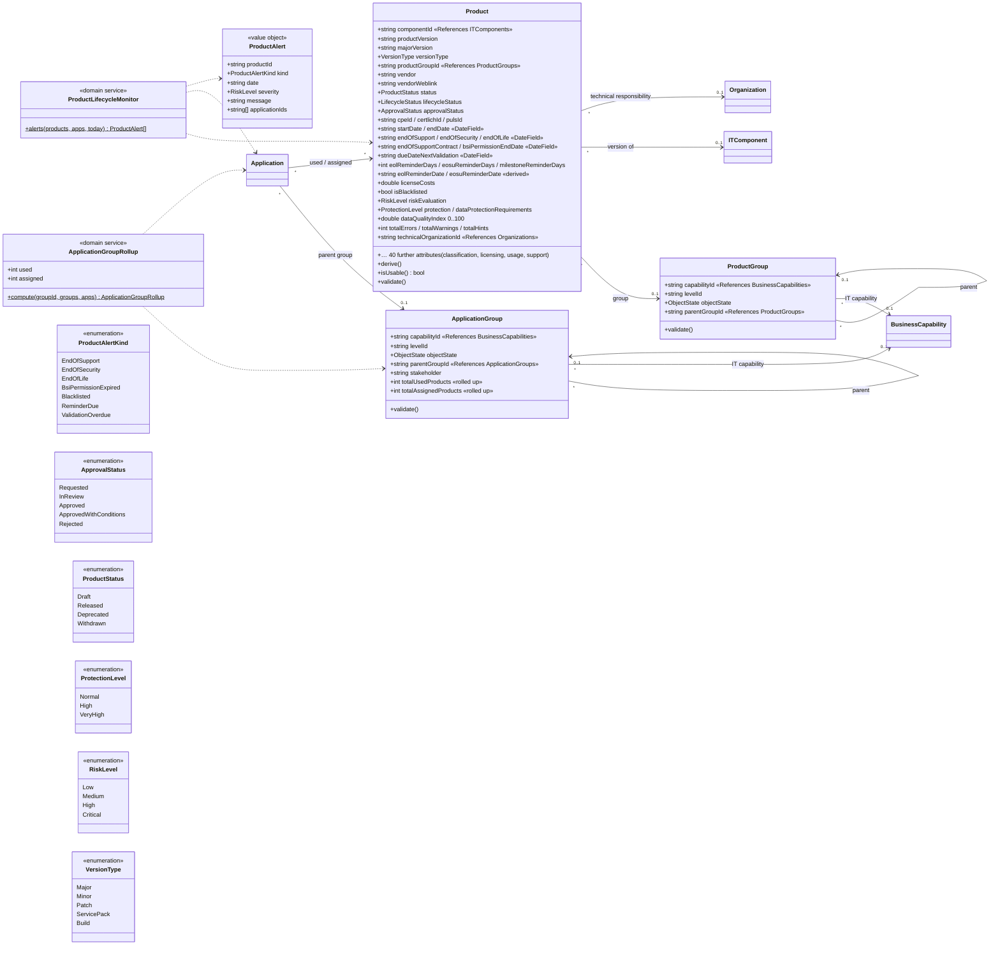

* **Derived values** are computed by the entity's `derive()` before validation. They are
  `totalUsedProducts` and `totalAssignedProducts` (distinct product references) and the reminder dates
  `eolReminderDate = endOfLife − eolReminderDays` and `eosuReminderDate = endOfSupport − eosuReminderDays`.
* **Roll-up**: the application group totals are computed at read time by an *enricher* that
  `composition.d` registers on the group interactor (`ApplicationGroupRollup` over the group subtree,
  with cycle protection), so they are never stale.
* Rules: a blacklisted product cannot be (conditionally) approved, weblinks must be http(s), and the
  data-quality index must be 0..100.

---

## 3. Business architecture & service catalogue

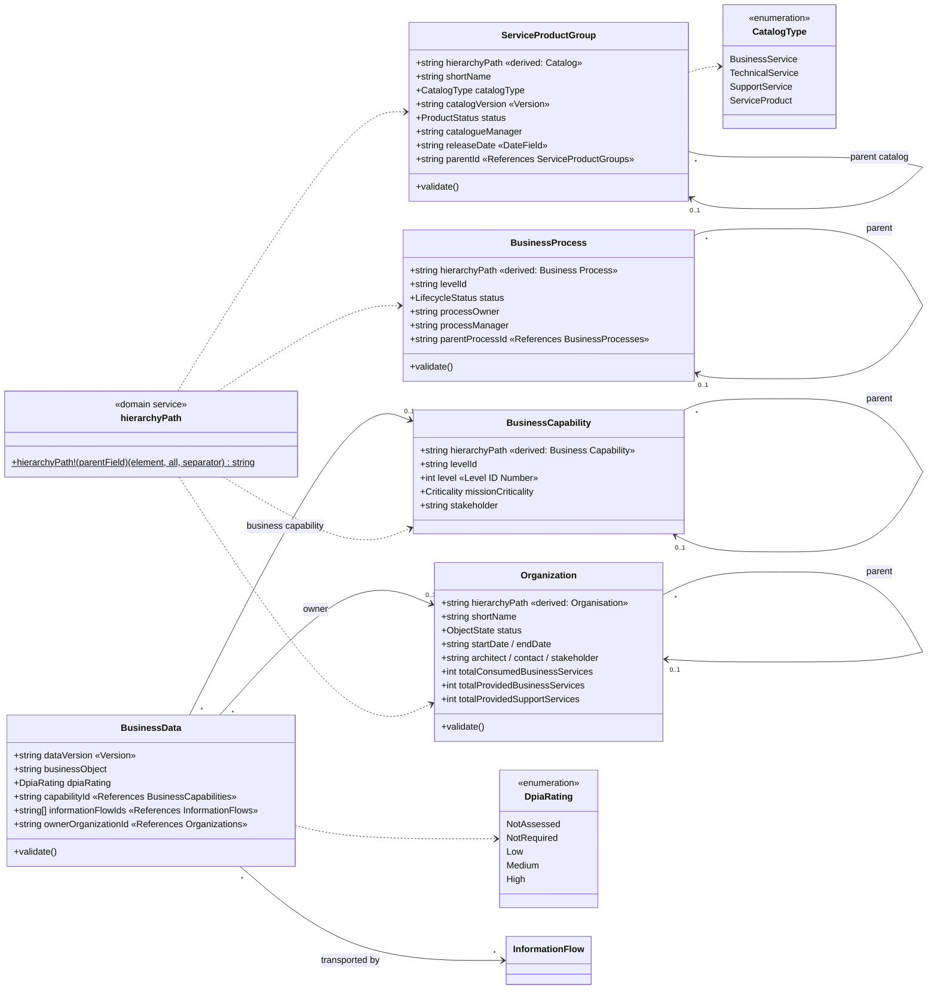

The first column of the Neko reports (*Organisation*, *Business Capability*, *Business Process*,
*Catalog*) is the **hierarchy path**. It is not stored: the composition root registers a read-time
enricher per set (`ManageElementsInteractor.enrichWith`) that walks the parent chain with
`hierarchyPath!"parentId"` (cycle-safe). Rules: an organisation past its end date cannot be *Active*,
an *Active* process needs an owner, business data rated *Medium*/*High* in the DPIA needs an owner, and a
*Released* catalogue needs a date of release.

---

## 4. IT landscape planning

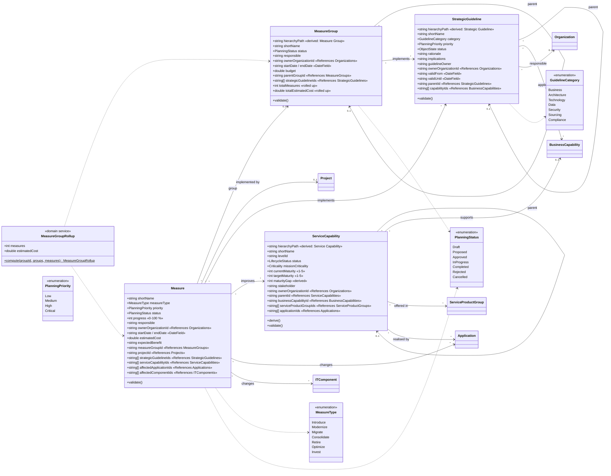

The **IT landscape planning** (*IT-Bebauungsplanung*) links the IT strategy to concrete changes:
strategic guidelines (principles such as *Cloud first*) are implemented by measure groups (roadmap streams)
and measures; measures improve service capabilities and change applications and IT components; a project
can implement several measures. Derived at read time: the hierarchy paths, the **maturity gap** of a service
capability (target − current, never negative) and the **totals of a measure group** (number and estimated
cost of the measures of its subtree, rejected and cancelled measures excluded).
Rules: an *Active* guideline needs an owner and a rationale; maturity levels are 1–5; an *Approved* group or
an *Approved* / *InProgress* measure needs a responsible person; a running measure needs a start date; a
*Completed* measure is at 100 %; *Retire* and *Migrate* measures must name the affected applications or
IT components. ArchiMate export: Principle, Capability, Grouping and WorkPackage.

---

## 5. Specifications

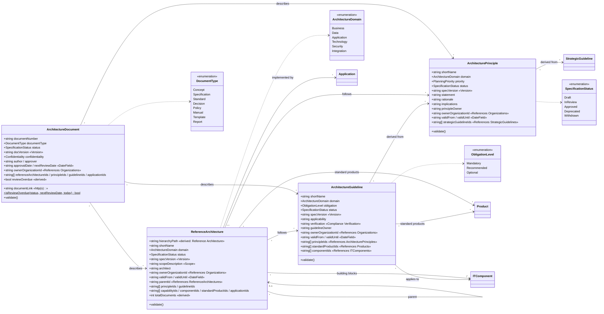

The **specifications** form a chain from strategy to solution: strategic guidelines → architecture
principles (statement, rationale, implications) → architecture guidelines (checkable rules, optionally with
standard products) → reference architectures (blueprints from building blocks) → applications that implement
them. Architecture documents (concepts, specifications, decisions/ADRs, policies …) describe all of them.
Derived at read time: the hierarchy path and the **number of documents** of a reference architecture, and
**Review Overdue** of a document (*Approved* and next review date in the past).
Rules: an *Approved* principle needs owner, statement and rationale; an *Approved* guideline needs an owner;
a *Mandatory* guideline is derived from at least one principle; an *Approved* reference architecture needs an
architect and at least one principle or guideline; an *Approved* document needs approver and approval date;
the document link must be an http(s) URL. ArchiMate export: Principle, Constraint (mandatory guideline) /
Requirement, Grouping and Representation.

---

## 6. Project management

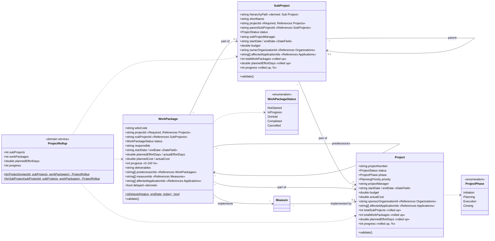

**Project management** structures a project into (nested) sub projects and work packages (WBS). Derived at
read time: the path *project / sub project / …*, the number of sub projects and work packages, the planned
effort and the **progress** – the planned-effort weighted mean of the work package progress (unweighted if
no effort is planned; cancelled work packages ignored). For a sub project the work packages of its nested
sub projects count as well. A work package is **Delayed** when it is neither *Completed* nor *Cancelled*
and its end date has passed. Rules: a work package and a sub project need a project; a running sub project
needs a manager; a running work package needs a responsible person and a start date; a *Completed* work
package is at 100 %; a work package cannot be its own predecessor; efforts and costs ≥ 0; a *Completed*
project needs an end date. ArchiMate export: WorkPackage with Composition (project → sub project → work
package) and Triggering (predecessor → successor).

---

## 7. Access management

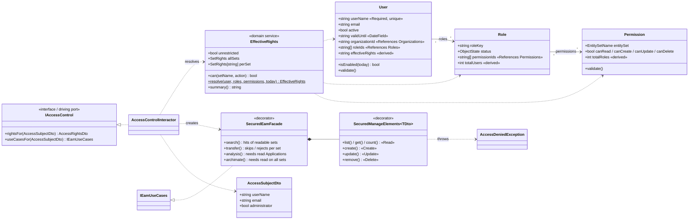

**Authorization** is part of the application core, not of a single adapter. Each adapter turns its caller into
an `AccessSubjectDto` (HTTP: JWT user name / e-mail and `Admin` scope, or the `eam-dev-user` cookie locally;
CLI `--user`; desktop `EAM_USER`) and asks `IAccessControl.useCasesFor(subject)` for the use cases. For an
administrator these are the plain use cases; otherwise a `SecuredEamFacade` whose `SecuredManageElements`
check *read / create / update / delete* per entity set and throw `AccessDeniedException` (HTTP 403).
Effective rights = union of the permissions of the user's *active* roles; *All* covers every set except
Users, Roles and Permissions. Without any users in the repository everybody may read (bootstrap). The
`EntitySetName` enumeration is checked against the DTO registry at compile time.

---

## 8. Organisation structure

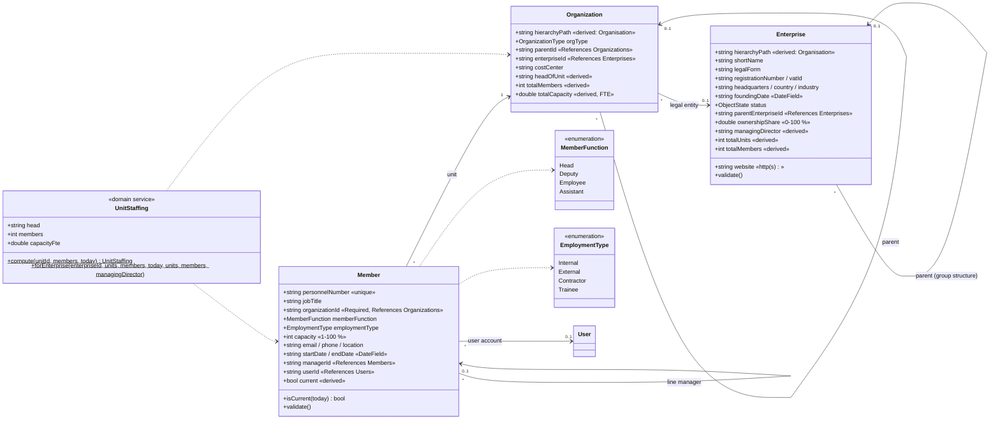

The **organisation structure** (*Aufbau*) separates the legal view (enterprises with group structure and
ownership shares) from the management view (the organisational unit hierarchy – a unit may belong to a
different legal entity than its parent unit, e.g. *Group IT* under the group but employed by the IT
subsidiary). Members are people in a unit; only **current** members (today within start / end date) count.
Derived at read time: head of unit, member count and capacity in FTE per unit; units, members and the
**managing director** of an enterprise – the current head of its top-level unit(s). The managing director is
deliberately not a stored reference: Enterprise → Member → Unit → Enterprise would be a cycle that a CSV / XLSX
import into an empty repository cannot resolve. Rules: at most one current *Head* per unit (checked against the
other members), unique personnel numbers, capacity 1–100 %, an end date for external members, contractors and
trainees. Members contain personal data: they are not exported to ArchiMate, and access is controlled by
permissions on the *Members* set.

---

## 9. Platform: tenants, backup & restore

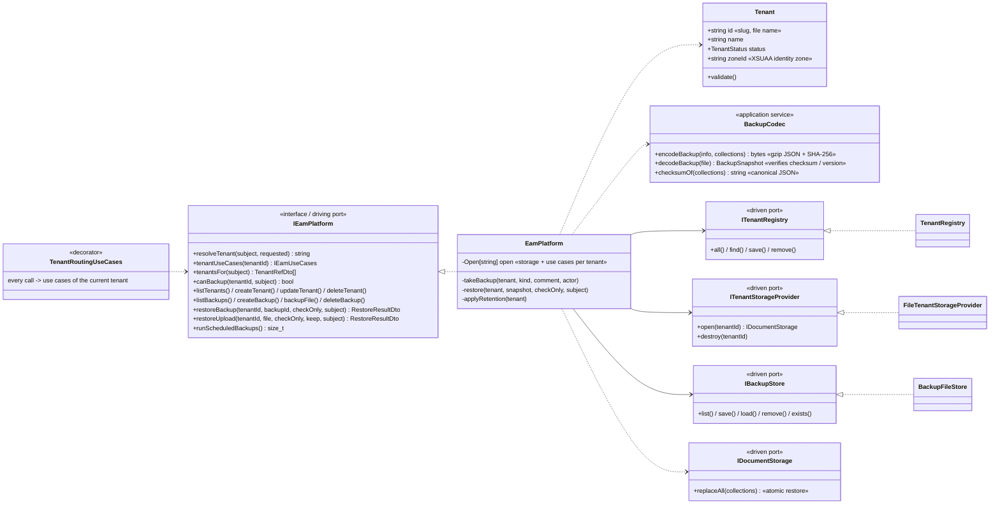

The **platform** sits above the tenants. The composition root builds one `EamPlatform` with a factory that
creates the complete use cases of a tenant on its storage (`EamContainer`). The HTTP adapters receive a
`TenantRoutingUseCases`: OData, REST, transfer and web cockpit keep working with "the" use cases, every call
reaches the tenant resolved for the request (zone → selection → `default`). CLI and desktop resolve the tenant
once per process. Because the repositories cache their records, a restore replaces the storage content in one
atomic write (`replaceAll`) and rebuilds the tenant's use cases.

---

## 10. Processes, security & reporting

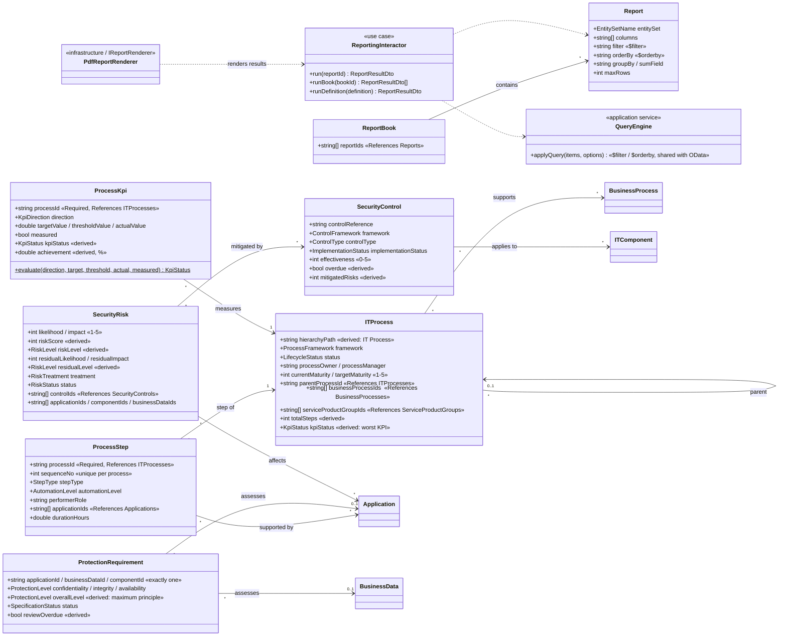

**Processes**: IT processes (ITIL 4 practices) with ordered steps and KPIs; a KPI is *OnTrack* when the target is
met, *AtRisk* up to the threshold, *OffTrack* beyond it; the process shows its worst KPI. **Security**: the
protection requirement follows the maximum principle (BSI 200-2); risk score = likelihood × impact (1–4 Low,
5–9 Medium, 10–16 High, 17–25 Critical), residual risk after the controls. **Reporting**: report definitions are
executed by the `ReportingInteractor` against the (checked) use cases of the caller with the OData query engine,
which was moved from the OData adapter into the application layer for this purpose; results are rendered as
XLSX / CSV (table codecs) or PDF (`PdfReportRenderer`).

---

## 11. Comments (journal)

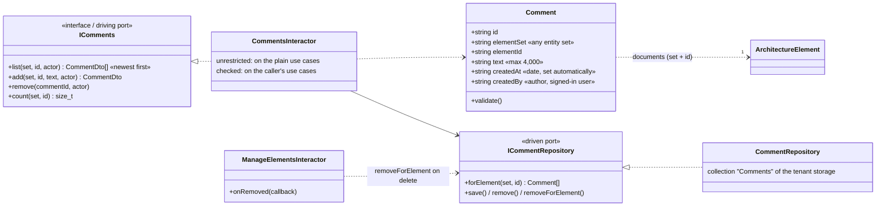

The journal is **polymorphic**: a comment refers to any element by entity set and id. It is append-only.
Authorization reuses the element: the checked `CommentsInteractor` looks the element up through the caller's
use cases (read permission), deleting another user's comment needs the delete permission on that set. Every
`ManageElementsInteractor` calls `onRemoved` after a delete, which removes the element's comments. The comments
live in the tenant storage and are therefore part of backups and restores.

---

## 12. Ports & use cases

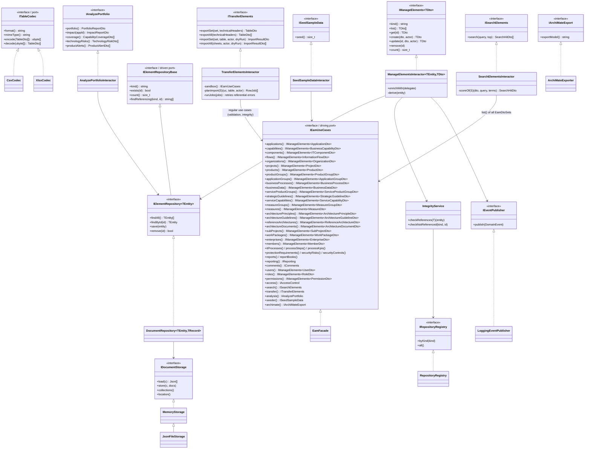

---

## 13. Component diagram (hexagonal architecture)

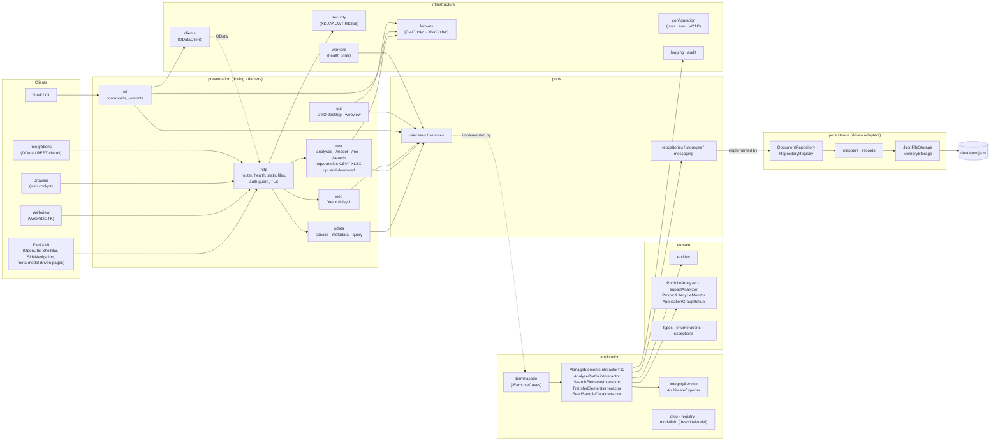

**Composition root:** `composition.d` (`EamContainer`) creates storage → repositories → registry →
integrity service → interactors (plus the application group roll-up enricher) → facade. `app.d` selects the
channel: `serve`, `gui`, `webview` or CLI.

## 14. Sequence: create an application via OData

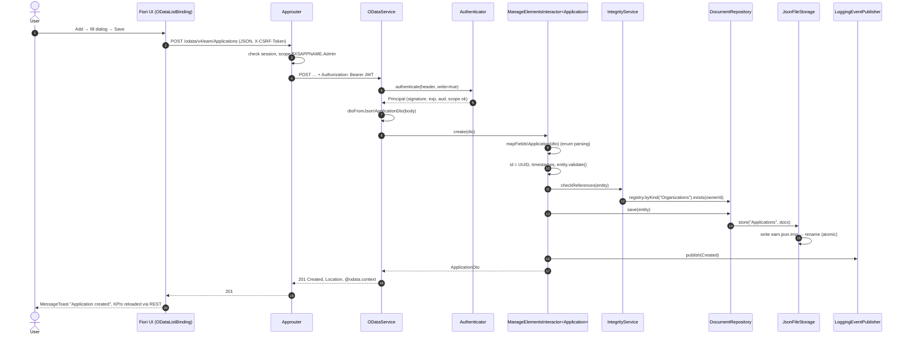

## 15. Sequence: delete with referential integrity

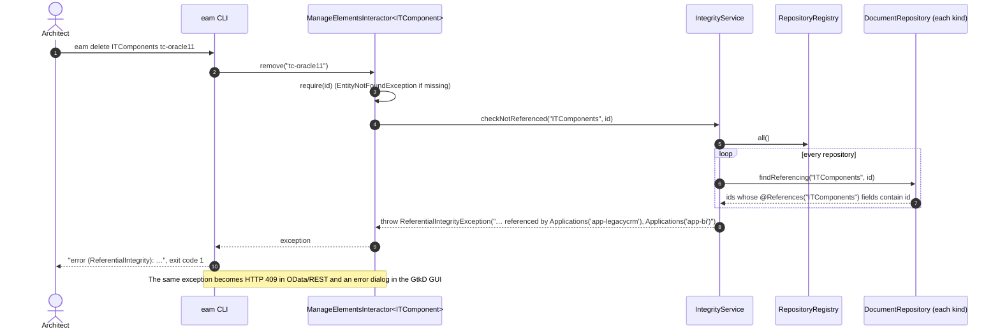

## 16. Sequence: WebView start-up

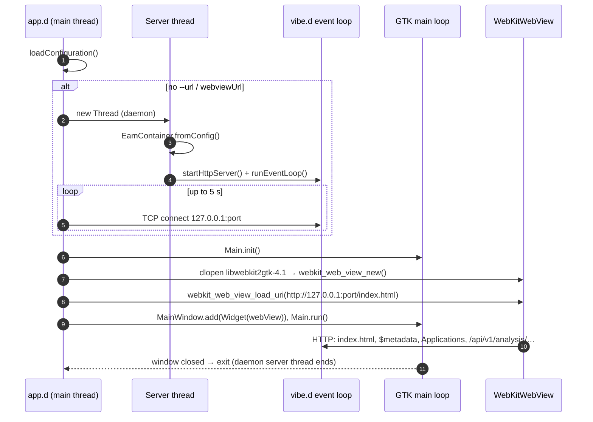

## 17. Sequence: Fiori shell start-up (user profile & meta model)

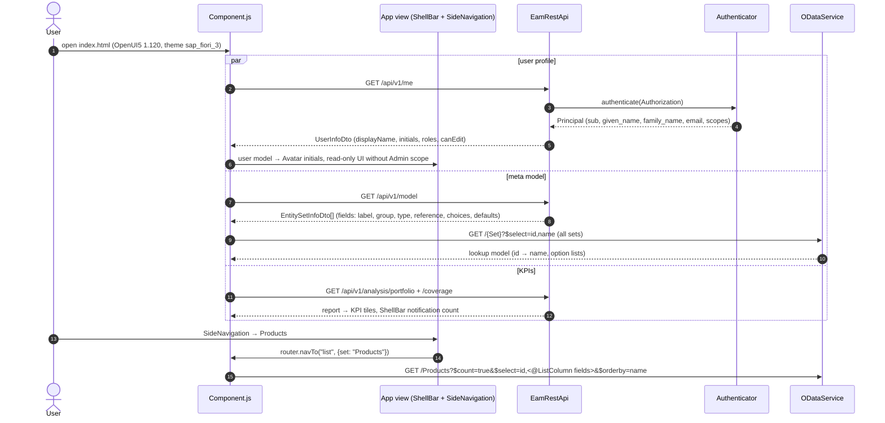

## 18. Sequence: edit on the object page (Edit → Save)

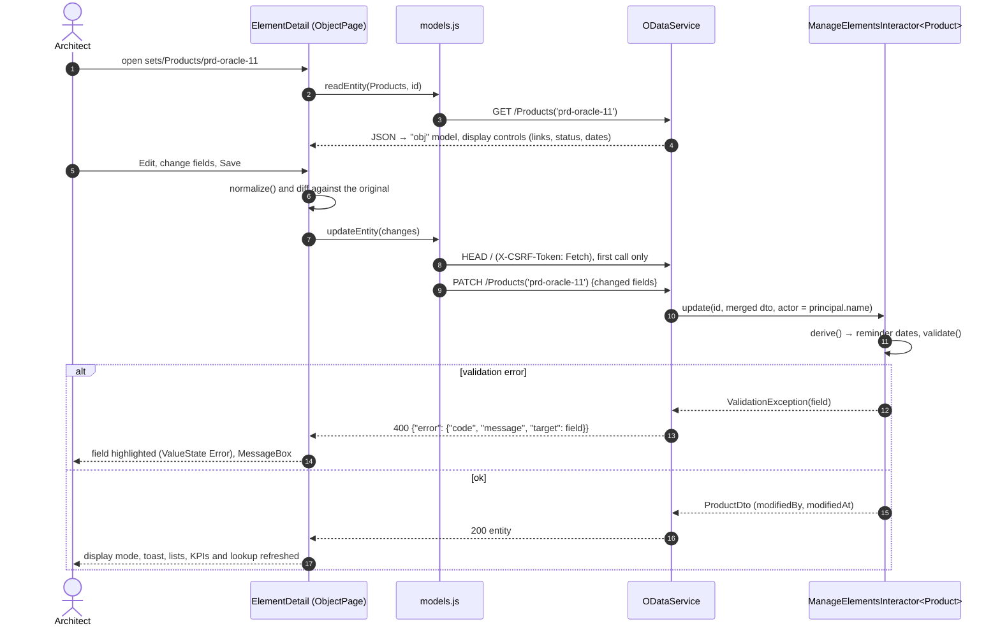


## 19. Sequence: central search (shell bar)

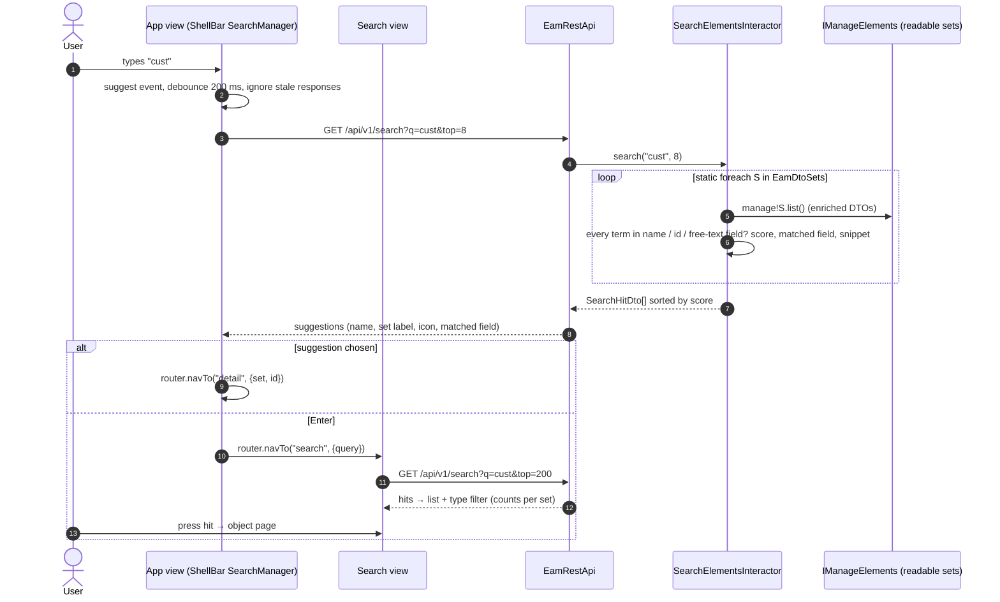

---

## 20. Sequence: CSV / XLSX import (check, then import)

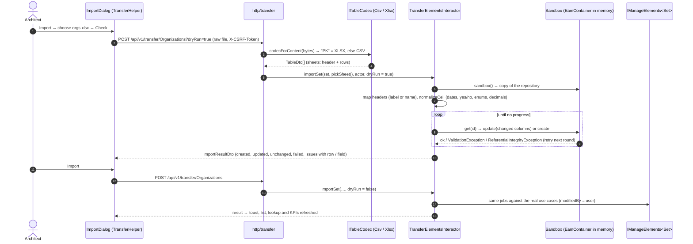

---

## 21. Deployment diagram

```mermaid
flowchart TB
    subgraph Workstation["Architect workstation (Linux)"]
        EAMBIN["eam (desktop build)<br/>serve · gui · webview · CLI"]
        GTK["GTK 3 / WebKit2GTK 4.1<br/>(runtime, dlopen)"]
        JSON1[("data/eam.json")]
        EAMBIN --- GTK
        EAMBIN --- JSON1
    end

    subgraph BTP["SAP BTP – Cloud Foundry space"]
        subgraph APPR["eam-approuter (nodejs_buildpack)"]
            ROUTER["@sap/approuter<br/>xs-app.json"]
            RES["resources/ = frontend (Fiori 3)"]
        end
        subgraph BE["eam-backend (binary_buildpack)"]
            HEADLESS["eam-headless serve<br/>PORT from CF, authMode=xsuaa"]
            JSON2[("data/eam.json<br/>(ephemeral – use volume/DB)")]
        end
        XSUAA[["XSUAA service<br/>xs-security.json"]]
    end

    USER(("Browser user")) -->|HTTPS| ROUTER
    ROUTER -->|OAuth2 login| XSUAA
    ROUTER -->|"destination eam-backend<br/>+ forwarded JWT"| HEADLESS
    HEADLESS -->|verificationkey from VCAP_SERVICES| XSUAA
    HEADLESS --- JSON2
    EAMBIN -.->|"CLI --remote / webview --url"| ROUTER
```

---

## 22. Use case diagram

```mermaid
flowchart LR
    EA(["Enterprise Architect<br/>(EAM_Architect)"])
    VI(["Stakeholder / Viewer<br/>(EAM_Viewer)"])
    OPS(["Operator / CI"])

    subgraph EAM["Neko EAM"]
        U1(("Maintain applications"))
        U2(("Maintain capability map"))
        U3(("Maintain IT components"))
        U4(("Maintain information flows"))
        U5(("Maintain organizations & projects"))
        U13(("Maintain product catalogue<br/>& product groups"))
        U14(("Maintain application groups<br/>& product assignments"))
        U15(("Product lifecycle alerts"))
        U16(("Manage own profile<br/>(language, theme)"))
        U17(("Maintain process map, business data<br/>& organisations"))
        U18(("Maintain service catalogue"))
        U19(("Central search"))
        U20(("Import / export<br/>CSV & Excel"))
        U21(("Plan IT landscape<br/>(guidelines, service capabilities,<br/>measures)"))
        U24(("Manage users, roles<br/>& permissions"))
        U25(("Maintain organisation structure<br/>(organisations, units, members)"))
        U28(("Manage IT processes<br/>& KPIs"))
        U29(("Information security<br/>(protection, risks, controls)"))
        U30(("Run & export reports"))
        U31(("Comment elements<br/>(journal)"))
        U26(("Back up & restore<br/>the tenant"))
        U27(("Manage tenants"))
        U23(("Manage projects<br/>(sub projects, work packages,<br/>progress)"))
        U22(("Maintain specifications<br/>(principles, guidelines,<br/>reference architectures, documents)"))
        U6(("Browse repository"))
        U7(("TIME portfolio assessment"))
        U8(("Technology risk analysis"))
        U9(("Capability coverage"))
        U10(("Impact analysis"))
        U11(("Export ArchiMate"))
        U12(("Seed demo data / health check"))
    end

    EA --> U1 & U2 & U3 & U4 & U5 & U13 & U14 & U17 & U18 & U20 & U21 & U22 & U23 & U24 & U25 & U26 & U28 & U29 & U30
    VI --> U30 & U31
    OPS --> U27 & U26
    EA --> U7 & U10 & U11
    VI --> U6 & U7 & U8 & U9 & U10 & U15 & U16 & U19
    OPS --> U12 & U11
```

## 23. State diagram: application lifecycle

```mermaid
stateDiagram-v2
    [*] --> Plan
    Plan --> Build : project approved
    Build --> Active : go-live (goLiveDate)
    Active --> PhaseOut : TIME = Migrate / Eliminate
    PhaseOut --> Active : decision reverted
    PhaseOut --> Retired : switched off (retirementDate required)
    Plan --> Retired : cancelled
    Retired --> [*]

    note right of Active
        isOperational() = Active or PhaseOut
        counts toward cost, coverage and technology risk
    end note
```

## 24. State diagram: measure planning status

```mermaid
stateDiagram-v2
    [*] --> Draft
    Draft --> Proposed : submitted to the architecture board
    Proposed --> Approved : approved (responsible required)
    Proposed --> Rejected : violates a guideline / no budget
    Approved --> InProgress : started (start date required)
    InProgress --> Completed : progress = 100 %
    Approved --> Cancelled
    InProgress --> Cancelled
    Rejected --> [*]
    Cancelled --> [*]
    Completed --> [*]

    note right of Rejected
        Rejected and cancelled measures are
        excluded from the measure group totals
    end note
```

## 25. State diagram: work package status

```mermaid
stateDiagram-v2
    [*] --> NotStarted
    NotStarted --> InProgress : started (responsible and start date required)
    InProgress --> OnHold
    OnHold --> InProgress
    InProgress --> Completed : progress = 100 %
    NotStarted --> Cancelled
    InProgress --> Cancelled
    OnHold --> Cancelled
    Completed --> [*]
    Cancelled --> [*]

    note right of InProgress
        Delayed = not Completed / Cancelled
        and end date in the past
    end note
```

## 26. Sequence: authorization of a request

```mermaid
sequenceDiagram
    autonumber
    actor User as Fiori user (EAM_Viewer)
    participant AR as Approuter
    participant OD as ODataService
    participant AU as Authenticator
    participant AC as AccessControlInteractor
    participant SF as SecuredEamFacade
    participant UC as ManageElementsInteractor

    User->>AR: PATCH /odata/v4/eam/Applications('app-crm')
    AR->>AR: login, scope $XSAPPNAME.Display, CSRF
    AR->>OD: request + JWT
    OD->>AU: authenticate(JWT)
    AU-->>OD: Principal (user name, e-mail, scopes)
    OD->>AC: useCasesFor(subject)
    AC->>AC: find user (name / e-mail), active roles -> EffectiveRights
    alt Admin scope
        AC-->>OD: plain use cases
    else repository user
        AC-->>OD: SecuredEamFacade(rights)
    end
    OD->>SF: applications.update(id, dto, actor)
    alt Applications: Update granted
        SF->>UC: update(...)
        UC-->>OD: ApplicationDto
        OD-->>User: 200 OK
    else not granted
        SF-->>OD: AccessDeniedException
        OD-->>User: 403 Forbidden "No permission to update Applications"
    end
```

## 27. Sequence: restore a backup

```mermaid
sequenceDiagram
    autonumber
    actor Admin as Tenant administrator
    participant UI as Fiori Backups page
    participant SR as System routes (/api/v1/backups)
    participant PL as EamPlatform
    participant BS as BackupFileStore
    participant BC as BackupCodec
    participant ST as Tenant storage (JsonFileStorage)

    Admin->>UI: Restore (row)
    UI->>SR: POST /backups/{id}/restore?check=true
    SR->>PL: restoreBackup(tenant, id, checkOnly=true, subject)
    PL->>PL: canBackup(tenant, subject)?
    PL->>BS: load(tenant, id)
    PL->>BC: decodeBackup(file)
    BC-->>PL: snapshot (format, version, SHA-256 verified)
    PL->>PL: test load of every set into an in-memory container
    PL-->>UI: RestoreResultDto (counts, warnings)
    UI->>Admin: confirm "all current data will be replaced"
    Admin->>UI: Restore
    UI->>SR: POST /backups/{id}/restore
    SR->>PL: restoreBackup(tenant, id, checkOnly=false, subject)
    PL->>BS: save(PreRestore safety backup of the current state)
    PL->>ST: replaceAll(collections)  (tmp file + rename)
    PL->>PL: rebuild the tenant's use cases (repository caches)
    PL-->>UI: restored, safetyBackupId
    UI->>UI: reload the app
```
